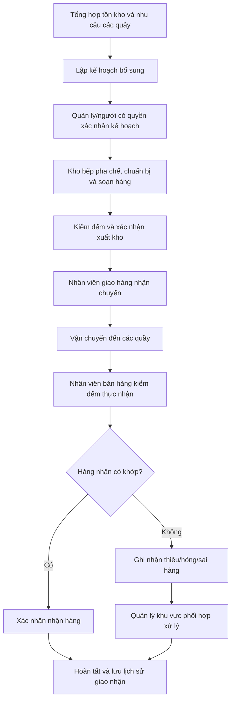
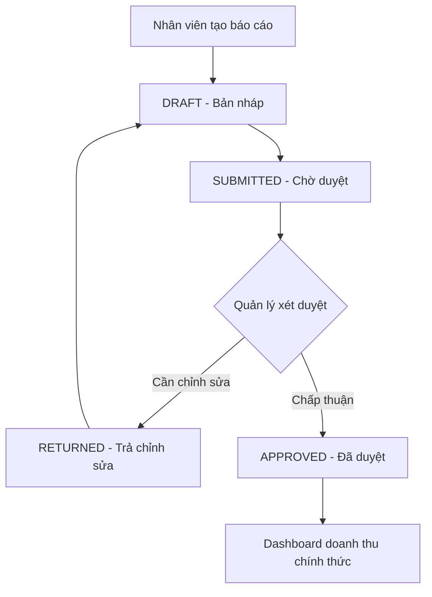

> **Backend PostgreSQL/Prisma ? 21/11/2026:** Runtime kh?ng c?n k?t n?i MongoDB.
> H??ng d?n hi?n h?nh v? c?c gi?i h?n d? li?u/quy?n Aiven ?
> [backend/docs/postgresql-runtime-audit.md](backend/docs/postgresql-runtime-audit.md).
> Ki?m th? localhost: Backend c?ng **5001**, Web c?ng **3000**; gi? ch? ?? Aiven ch? ??c.
> C?c h??ng d?n MongoDB/migration c? b?n d??i l? l?ch s?, kh?ng ph?i lu?ng kh?i ??ng hi?n h?nh.

# ĐỒ ÁN CHUYÊN NGÀNH
## TÊN ĐỒ ÁN: WAVEHOUSE MANAGEMENT SYSTEM
### CHỨC NĂNG:
#### Quản lý nhập hàng
#### Quản lý kho
#### Quản lý xuất kho
#### Ứng dụng AI: Tổng kết cuối ngày, đề xuất gom hàng, đề xuất tuyền đường, số nguyên liệu cần giao cho mỗi quầy vào ngày tiếp theo
---
##  Công Nghệ Sử Dụng
*   **Backend Main API:** Node.js + ExpressJS + TypeScript
*   **AI Service:** Python + FastAPI + Gemini API + RAG (Retrieval-Augmented Generation)
*   **Frontend Web (Admin):** React + Vite + TypeScript
*   **Mobile App (Kiểm kho):** React Native + Expo Go + TypeScript
*   **Database & Tools:** MongoDB (Docker), Socket.io (Real-time), Swagger (API Docs), Postman, Jira, GitHub.
---
## 📁 Kiến Trúc Thư Mục Dự Án (Monorepo)

```text
📁 WaveHouseManagement
├── 📁 backend           # Mã nguồn Node.js API chính (Cổng 5000)
├── 📁 web               # Giao diện Web Admin dành cho chủ quán (Cổng 3000)
├── 📁 mobile-app        # Ứng dụng di động Expo Go cho nhân viên kiểm kho
├── 📁 ai-service        # Dịch vụ Python RAG & Xử lý AI Gemini (Cổng 8000)
├── 📁 mongodb_data      # Thư mục chứa dữ liệu cứng của MongoDB (Docker tự quản lý)
└── docker-compose.yml   # File cấu hình khởi chạy toàn bộ hệ thống bằng Docker
```

---

## 🚀 Hướng Dẫn Cài Đặt và Khởi Chạy Dự Án (Setup Guide)

Dành cho người mới tiếp cận dự án, hãy làm theo tuần tự các bước dưới đây để chạy thử hệ thống trên máy cá nhân:

### 1. Yêu Cầu Cài Đặt Sẵn Trên Máy (Prerequisites)
*   [Node.js](https://nodejs.org) (Phiên bản v18 trở lên)
*   [Python](https://python.org) (Phiên bản 3.10 trở lên)
*   [Docker Desktop](https://docker.com)
*   Ứng dụng **Expo Go** trên điện thoại (để chạy thử App Mobile)

### 2. Tải Mã Nguồn Về Máy
```bash
git clone https://github.com/xuanhiepwork/wavehouseManagement.git
cd wavehouseManagement
```

### 3. Cấu Hình Biến Môi Trường (.env)
*   Vào thư mục `backend/` tạo file `.env` và điền cấu hình database kết nối.
*   Vào thư mục `ai-service/` tạo file `.env` và điền `GEMINI_API_KEY=your_key_here`.

### 4. Khởi Chạy Database & Hệ Thống Bằng Docker (Cách nhanh nhất)
Mở Docker Desktop lên, sau đó tại thư mục gốc chạy lệnh:
```bash
docker-compose up --build
```
*Lệnh này sẽ tự động tải MongoDB, cài đặt và chạy Backend cùng AI Service.*

### 5. Khởi Chạy Các Ứng Dụng Frontend Để Phát Triển (Local Development)

#### Chạy Giao Diện Web Admin:
```bash
cd web
npm run dev
```

#### Chạy Ứng Dụng Mobile App:
```bash
cd mobile-app
npm start
```
*Sau khi chạy, dùng điện thoại quét mã QR hiển thị trên màn hình máy tính thông qua ứng dụng Expo Go để test App.*

---

## 📝 Nhật Ký Phát Triển & Quy Định Git

*   **Nhánh chính (`main`):** Nơi chứa code ổn định nhất, chỉ gộp code khi đã kiểm thử kỹ.
*   **Nhánh phát triển (`test` hoặc các nhánh tính năng con):** Thực hiện tính năng mới trên các nhánh này trước khi tạo Pull Request vào `main`.
*   **Tài liệu API:** Khi backend chạy, truy cập đường dẫn `http://localhost:5000/api-docs` để xem tài liệu Swagger đầy đủ.

---
# ĐẨY CODE LÊN GITHUB
  1. git status
  * Kiểm tra xem có thư mục node_modules hay venv, thì phải kiểm tra lại gitignore
  2. git add .
  3. git commit -m "ĐẶT TÊN NHÁNH"
  4. git push origin HEAD hoặc git push origin test(tên nhánh)           
  * Đẩy code lên nhánh hiện tại


---

## FIX CODEX ERROR
`
  code --install-extension openai.chatgpt@26.1007.21434 --force
`


---

# Công nghệ sử dụng và thiết kế cơ sở dữ liệu

## 1. Công nghệ sử dụng (Technology Stack)

Dự án **WaveHouse Management** được xây dựng theo kiến trúc Client–Server, sử dụng một Backend API chung để phục vụ hệ thống quản trị Web Admin và ứng dụng Mobile.

Hệ thống hướng đến khả năng mở rộng, quản lý dữ liệu tập trung, đảm bảo tính toàn vẹn dữ liệu và thuận tiện trong quá trình triển khai lên môi trường cloud.

### 1.1. Danh sách công nghệ

| Thành phần | Công nghệ lựa chọn | Vai trò |
|---|---|---|
| Database | PostgreSQL | Hệ quản trị cơ sở dữ liệu quan hệ, lưu trữ và quản lý dữ liệu tập trung |
| ORM | Prisma ORM | Tương tác với PostgreSQL, quản lý schema và database migrations |
| Database Viewer | Database Client (VS Code Extension) | Kết nối, truy vấn và quản lý dữ liệu trực tiếp trong Visual Studio Code |
| Local Development | Docker & Docker Compose | Xây dựng và quản lý môi trường phát triển bằng containers |
| Backend | Node.js + Express.js + TypeScript | Xây dựng RESTful API và xử lý nghiệp vụ |
| Web Admin | React + Vite + TypeScript | Phát triển giao diện quản trị trên trình duyệt |
| Mobile Application | React Native + Expo | Phát triển ứng dụng di động đa nền tảng |
| AI Service | Python + FastAPI + Google Gemini API | Xử lý AI, dự báo nhu cầu và hỗ trợ lập kế hoạch phân phối |
| AI Techniques | Machine Learning, Algorithms, LLM, RAG | Phân tích dữ liệu, dự báo và đề xuất phương án |
| Realtime Communication | Socket.IO | Đồng bộ trạng thái và gửi thông báo thời gian thực |
| API Documentation | Swagger / OpenAPI | Tài liệu hóa và kiểm thử API |
| API Testing | Postman | Kiểm thử các API endpoints |
| Cloud Database | Managed PostgreSQL (Neon hoặc Supabase) | Lưu trữ cơ sở dữ liệu khi triển khai production |
| Version Control | Git + GitHub | Quản lý phiên bản mã nguồn và cộng tác phát triển |
| Project Management | Jira | Quản lý công việc, tiến độ và các giai đoạn phát triển |

### 1.2. Kiến trúc hệ thống

Hệ thống sử dụng mô hình **Client–Server với một Backend API dùng chung**.

**Web Admin (React) / Mobile App (React Native)**

↓ HTTPS / REST API / Socket.IO

**Backend Server (Node.js + Express.js + TypeScript)**

- Xử lý các quy tắc nghiệp vụ.
- Quản lý xác thực và phân quyền.
- Quản lý nhập hàng, tồn kho và điều chuyển.
- Cung cấp API cho Web Admin và Mobile.
- Giao tiếp với PostgreSQL thông qua Prisma ORM.
- Kết nối AI Service để xử lý dự báo và lập kế hoạch.

**Các dịch vụ phía sau Backend:**

- **PostgreSQL:** Lưu trữ dữ liệu nghiệp vụ.
- **AI Service (Python + FastAPI):** Xử lý thuật toán, Gemini, LLM và RAG.
- **Socket.IO:** Đồng bộ trạng thái và thông báo thời gian thực.

Web Admin và Mobile App không truy cập trực tiếp vào cơ sở dữ liệu. Mọi thao tác đọc và ghi dữ liệu đều được thực hiện thông qua Backend API.

### 1.3. Môi trường phát triển và triển khai

**Development Environment**

- Docker Desktop và Docker Compose được sử dụng để chạy các dịch vụ tại máy phát triển.
- PostgreSQL chạy trong Docker container.
- Backend kết nối PostgreSQL thông qua Prisma ORM.
- Database Client Extension trong VS Code được sử dụng để xem dữ liệu, kiểm tra bảng và thực hiện truy vấn SQL.
- Các thông tin kết nối được quản lý bằng environment variables.

**Production Environment**

- Web Admin được triển khai trên nền tảng hosting hỗ trợ ứng dụng React.
- Backend và AI Service được triển khai dưới dạng các dịch vụ độc lập, có thể sử dụng Docker containers.
- PostgreSQL sử dụng dịch vụ managed database như Neon hoặc Supabase.
- Mobile App kết nối đến Backend thông qua HTTPS.
- Thông tin kết nối, API keys và credentials được lưu trữ bằng environment variables hoặc secret management.

---

## 2. Thiết kế cơ sở dữ liệu (Database Design)

### 2.1. Hệ quản trị cơ sở dữ liệu

Hệ thống sử dụng **PostgreSQL** làm cơ sở dữ liệu chính và **Prisma ORM** để quản lý các mô hình dữ liệu.

PostgreSQL được lựa chọn nhằm đáp ứng các yêu cầu:

- Quản lý dữ liệu có quan hệ giữa nhiều bảng.
- Đảm bảo tính toàn vẹn dữ liệu bằng Primary Key, Foreign Key và Constraints.
- Hỗ trợ Transactions cho các nghiệp vụ nhập, xuất và điều chuyển kho.
- Theo dõi lịch sử biến động tồn kho.
- Hỗ trợ truy vấn SQL, thống kê và báo cáo.
- Dễ dàng triển khai trên môi trường cloud.

### 2.2. Các nhóm dữ liệu dự kiến

Cơ sở dữ liệu được tổ chức thành sáu nhóm chính, phục vụ bốn module nghiệp vụ của hệ thống.

#### Nhóm 1 — Danh mục sản phẩm và nguyên liệu (Master Data)

Quản lý các dữ liệu nền tảng được sử dụng trong toàn hệ thống.

| Bảng dự kiến | Chức năng |
|---|---|
| `ingredients` | Danh mục nguyên liệu, đơn vị tính, giá tham khảo và ngưỡng tồn tối thiểu |
| `products` | Danh mục sản phẩm, đồ uống và thông tin kinh doanh |
| `product_prices` | Giá bán của sản phẩm theo kích thước |
| `recipes` | Công thức pha chế, phiên bản và trạng thái kích hoạt |
| `recipe_ingredients` | Danh sách nguyên liệu và định lượng của từng công thức |

#### Nhóm 2 — Chi nhánh và địa điểm lưu trữ (Organization & Locations)

Quản lý cấu trúc tổ chức và các địa điểm lưu trữ hàng hóa.

| Bảng dự kiến | Chức năng |
|---|---|
| `branches` | Thông tin chi nhánh, quầy bán hàng |
| `warehouses` | Thông tin kho tổng và các kho trực thuộc |
| `stock_locations` | Vị trí lưu trữ và phân loại địa điểm quản lý tồn kho |

#### Nhóm 3 — Quản lý nhập hàng (Purchasing & Receiving)

Phục vụ Module 1 — Quản lý nhập hàng.

| Bảng dự kiến | Chức năng |
|---|---|
| `suppliers` | Quản lý thông tin nhà cung cấp |
| `purchase_orders` | Quản lý đơn đặt hàng nhập |
| `purchase_order_items` | Chi tiết nguyên liệu, số lượng và giá đặt mua |
| `goods_receipts` | Quản lý phiếu nhập hàng thực tế |
| `goods_receipt_items` | Chi tiết số lượng thực nhận, giá nhập và chênh lệch |
| `batches` | Quản lý lô hàng, ngày nhập và hạn sử dụng |

**Nghiệp vụ chính:**

- Tạo và quản lý đơn đặt hàng.
- Ghi nhận hàng thực nhận.
- Đối chiếu số lượng đặt và số lượng nhận.
- Theo dõi giá nhập và lô nguyên liệu.
- Cập nhật tồn kho sau khi xác nhận nhập hàng.

#### Nhóm 4 — Quản lý tồn kho (Inventory Management)

Phục vụ Module 2 — Quản lý tồn kho.

| Bảng dự kiến | Chức năng |
|---|---|
| `stock_movements` | Ghi nhận lịch sử tăng, giảm và dịch chuyển tồn kho |
| `stock_balances` | Theo dõi số lượng tồn tại từng địa điểm và theo lô |
| `stock_adjustments` | Quản lý phiếu điều chỉnh tồn kho |
| `stock_adjustment_items` | Chi tiết nguyên liệu, số lượng điều chỉnh và nguyên nhân |

**Nghiệp vụ chính:**

- Theo dõi tồn kho theo từng kho và chi nhánh.
- Quản lý tồn kho theo nguyên liệu và lô hàng.
- Theo dõi hạn sử dụng.
- Ghi nhận hao hụt, hư hỏng và điều chỉnh kho.
- Cảnh báo tồn kho thấp và nguyên liệu sắp hết hạn.
- Truy xuất lịch sử biến động tồn kho.

**Nguyên tắc thiết kế:** Không chỉ lưu số lượng tồn hiện tại mà cần lưu lịch sử các giao dịch làm thay đổi tồn kho để phục vụ đối soát và truy vết.

#### Nhóm 5 — Quản lý xuất hàng và điều chuyển (Stock Transfers & Distribution)

Phục vụ Module 3 — Quản lý xuất hàng và điều chuyển.

| Bảng dự kiến | Chức năng |
|---|---|
| `stock_transfers` | Quản lý phiếu điều chuyển giữa các kho và chi nhánh |
| `transfer_items` | Chi tiết nguyên liệu, số lượng yêu cầu, xuất và nhận |
| `transfer_events` | Lịch sử thay đổi trạng thái và xử lý điều chuyển |

**Nghiệp vụ chính:**

- Tạo yêu cầu xuất và điều chuyển hàng.
- Phê duyệt hoặc từ chối yêu cầu.
- Soạn hàng và xác nhận xuất kho.
- Theo dõi trạng thái giao hàng.
- Xác nhận số lượng thực nhận.
- Ghi nhận hàng thiếu hoặc hư hỏng.
- Cập nhật tồn kho tại kho nguồn và kho đích.

Các thao tác làm thay đổi tồn kho cần được xử lý bằng database transactions để hạn chế tình trạng dữ liệu không nhất quán.

#### Nhóm 6 — AI Daily Inventory & Distribution Planning

Phục vụ Module 4 — AI Daily Inventory & Distribution Planning.

| Bảng dự kiến | Chức năng |
|---|---|
| `daily_inventory_snapshots` | Lưu dữ liệu tổng kết tồn kho theo ngày |
| `demand_forecasts` | Lưu kết quả dự báo nhu cầu nguyên liệu |
| `distribution_plans` | Lưu kế hoạch phân phối do AI đề xuất |
| `distribution_plan_items` | Chi tiết nguyên liệu, số lượng đề xuất và địa điểm nhận |
| `plan_approvals` | Lưu quyết định phê duyệt, chỉnh sửa hoặc từ chối đề xuất AI |

**Nghiệp vụ chính:**

- Tổng hợp tồn kho và mức tiêu thụ cuối ngày.
- Phân tích dữ liệu tiêu thụ lịch sử.
- Dự báo nhu cầu theo ngày thường, cuối tuần và ngày lễ.
- Đề xuất lượng nguyên liệu cần bổ sung cho từng chi nhánh.
- Hỗ trợ xây dựng kế hoạch và tuyến giao hàng.
- Cho phép người quản lý phê duyệt, điều chỉnh hoặc từ chối đề xuất AI.

Các kết quả AI chỉ đóng vai trò đề xuất; những thao tác làm thay đổi tồn kho thực tế phải được xác nhận và xử lý thông qua Backend.

---

## 3. Nguyên tắc thiết kế dữ liệu

Cơ sở dữ liệu sẽ tuân theo các nguyên tắc:

1. **Data Integrity:** Sử dụng khóa chính, khóa ngoại, unique constraints và các ràng buộc dữ liệu phù hợp.
2. **Transactional Consistency:** Các nghiệp vụ nhập, xuất, điều chuyển và cập nhật tồn kho phải đảm bảo tính nhất quán.
3. **Traceability:** Lưu lịch sử giao dịch và biến động tồn kho để hỗ trợ kiểm tra, đối soát.
4. **Batch Tracking:** Theo dõi nguyên liệu theo lô và hạn sử dụng.
5. **Multi-Location Inventory:** Quản lý tồn kho độc lập theo từng kho, chi nhánh và địa điểm lưu trữ.
6. **Recipe Versioning:** Lưu các phiên bản công thức pha chế và quản lý công thức đang hoạt động.
7. **Scalability:** Thiết kế cho phép mở rộng thêm chi nhánh, kho và nghiệp vụ trong tương lai.
8. **AI Separation:** AI Service xử lý dự báo và đề xuất, còn Backend chịu trách nhiệm kiểm tra và thực thi nghiệp vụ.
9. **Security:** Không lưu credentials, mật khẩu hoặc API keys trực tiếp trong mã nguồn.
10. **Migration Management:** Các thay đổi cấu trúc database được quản lý bằng Prisma Migrate.

---

## 4. Trạng thái thiết kế

**Trạng thái: Proposed Architecture — Chưa triển khai hoàn chỉnh.**

Danh sách bảng ở trên là thiết kế dự kiến, được sử dụng làm cơ sở cho việc xây dựng Entity Relationship Diagram (ERD), Prisma Schema và Database Migrations.

Tên bảng, quan hệ, thuộc tính và các ràng buộc có thể được điều chỉnh sau khi hoàn thành phân tích nghiệp vụ chi tiết.

Kiến trúc PostgreSQL + Prisma là công nghệ mục tiêu cho giai đoạn phát triển tiếp theo. Các thành phần MongoDB/Mongoose còn tồn tại trong repository sẽ được đánh giá và chuyển đổi theo kế hoạch migration đã được phê duyệt.


---

## Quy tắc đặt tên nhánh

Cấu trúc:

```text
<loại>/<phạm-vi>-<nội-dung>
```

Ví dụ: `feature/backend-stock-import`

### Loại công việc

| Tiền tố | Mục đích | Ví dụ |
| --- | --- | --- |
| `feature/` | Thêm chức năng | `feature/backend-stock-import` |
| `fix/` | Sửa lỗi | `fix/web-inventory-filter` |
| `refactor/` | Cải tổ code, giữ nguyên hành vi | `refactor/backend-stock-service` |
| `chore/` | Cấu hình, cập nhật thư viện, bảo trì | `chore/backend-eslint` |
| `docs/` | Viết hoặc sửa tài liệu | `docs/backend-stock-import-api` |
| `tests/` | Thêm hoặc sửa kiểm thử | `tests/backend-stock-import` |
| `feature/web-` | Thêm giao diện hoặc chức năng trên web | `feature/web-login-page` |
| `feature/mobile-` | Thêm giao diện hoặc chức năng trên mobile | `feature/mobile-login-screen` |.


---
## SỬ DỤNG GITHUB

### Bước 1 — Kiểm tra và cập nhật thông tin Git
```
git status
git fetch origin
```

### Bước 2 — Chuyển sang nhánh test
```
git switch test
```

### Bước 3 — Cập nhật nhánh test từ GitHub
```
git pull --ff-only origin test
```

### Bước 4 — Merge code từ backend sang test
```
git merge backend
```

### Bước 5 — Push nhánh test lên GitHub (Sau khi merge thành công)
```
git push origin test
```

---

# SỬ DỤNG ĐIỆN THOẠI DEBBUG

## BƯỚC 1:KẾT NỐI VỚI ĐIỆN THOẠI ANDROI

### CHẾ ĐỘ NHÀ PHÁT TRIỂN >>> GỠ LỖI KHÔNG DÂY >>> GHÉP NỐI THIẾT BỊ BẰNG MÃ GHÉP NỐI

```
$adb = 'C:\Android\Sdk\platform-tools\adb.exe'

& $adb pair 192.168.2.57:37319
```

#### Nhập mã trên điện thoại vào khi terminal hỏi


## BƯỚC 2: KẾT NỐI ADB
```
$adb = 'C:\Android\Sdk\platform-tools\adb.exe'

# Thay CONNECTION_PORT bằng Cổng & Địa chỉ IP trên màn hình Gỡ lỗi không dây
Test-NetConnection 192.168.2.57 -Port 42441

& $adb connect 192.168.2.57:42441
& $adb devices -l

```

## BƯỚC 3: KẾT NỐI
### CHẠY CÂU LỆNH SAU ĐỂ KIỂM TRA VÀ LẤY SỐ SERIES:
```
$adb = 'C:\Android\Sdk\platform-tools\adb.exe'
& $adb devices -l
```

### MÃ TRƯỚC CHỮ DEVICE LÀ SERIES...

### Nhập câu lệnh sau khi đã có số series:
```
$phoneSerial = 'THAY_BANG_SERIAL_THUC_TE'
# Không được bỏ dấu '  '

& $adb -s $phoneSerial get-state
& $adb -s $phoneSerial shell getprop ro.product.brand
& $adb -s $phoneSerial shell getprop ro.product.model
```

### Kiểm tra không có dịch vụ laptop đang dùng cổng thử nghiệm
Get-NetTCPConnection -LocalPort 17500 -State Listen `
  -ErrorAction SilentlyContinue

### Kiểm tra các mapping hiện có trên điện thoại
```
& $adb -s $phoneSerial reverse --list

$created = $false

try {
    & $adb -s $phoneSerial reverse --no-rebind tcp:17500 tcp:17500

    if ($LASTEXITCODE -ne 0) {
        throw 'Không tạo được mapping thử nghiệm.'
    }

    $created = $true

    Write-Host '=== ADB reverse mappings ==='
    & $adb -s $phoneSerial reverse --list

    Write-Host '=== Phone TCP listeners ==='
    & $adb -s $phoneSerial shell ss -ltn
}
finally {
    if ($created) {
        & $adb -s $phoneSerial reverse --remove tcp:17500
        Write-Host 'Đã gỡ mapping thử nghiệm 17500.'
    }
}
```

---

# Triển khai lên Aiven Cloud

## Trong Terminal có biến AIVEN_ADMIN_DB_PASSWORD:
```
.\node_modules\.bin\prisma.cmd migrate status `
    --config .\prisma.config.aiven.ts
```

## Sau khi kiểm tra, chạy:
```
.\node_modules\.bin\prisma.cmd migrate deploy `
    --config .\prisma.config.aiven.ts
```

## Build Backend:
```
.\node_modules\.bin\prisma.cmd generate
if ($LASTEXITCODE -ne 0) { throw 'B7 GENERATE FAILED' }

.\node_modules\.bin\tsc.cmd --noEmit
if ($LASTEXITCODE -ne 0) { throw 'B7 TYPECHECK FAILED' }

.\node_modules\.bin\tsc.cmd
if ($LASTEXITCODE -ne 0) { throw 'B7 BUILD FAILED' }

Write-Host 'B7 BUILD SUCCESS'
```


---

# Đăng nhập vào PostgreSQL trên Aiven Cloud

```
& "C:\Program Files\PostgreSQL\18\bin\psql.exe" `
  "host=do-an-he-thong-quan-ly-kho-do-an-2026.b.aivencloud.com port=24631 dbname=wavehouse_dev user=avnadmin sslmode=require" `
  -W
```

## Thoát khỏi psql 
### Tại "wavehouse_dev=>" nhập
```
\q
```

## Chạy backup riêng database trước khi deploy
```
$pgDump = "C:\Program Files\PostgreSQL\18\bin\pg_dump.exe"

$backupDir = Join-Path $env:USERPROFILE "Documents\WaveHouseBackups"
New-Item -ItemType Directory -Path $backupDir -Force | Out-Null

$backupFile = Join-Path $backupDir "wavehouse_dev_before_migrations_$(Get-Date -Format 'yyyyMMdd_HHmmss').dump"

try {
    & $pgDump `
      --host=do-an-he-thong-quan-ly-kho-do-an-2026.b.aivencloud.com `
      --port=24631 `
      --username=avnadmin `
      --dbname=wavehouse_dev `
      --format=custom `
      --no-password `
      --file="$backupFile"
} finally {
    Remove-Item Env:PGPASSWORD -ErrorAction SilentlyContinue
}

if ($LASTEXITCODE -ne 0) {
    throw "Backup failed. Do not deploy migrations."
}
```

---

---


---

# TÀI LIỆU TỔNG QUAN NGHIỆP VỤ VÀ ĐỊNH HƯỚNG PHÁT TRIỂN WAVEHOUSE MANAGEMENT

> **Phiên bản tài liệu:** 1.0  
> **Ngày cập nhật:** 25/11/2026  
> **Dự án:** WaveHouseManagement  
> **Mục đích:** Giúp thành viên mới, lập trình viên, người quản lý và những người tiếp nhận dự án hiểu được mô hình hoạt động, kiến trúc, nghiệp vụ và định hướng phát triển của hệ thống.

> **Lưu ý quan trọng:** Tài liệu này mô tả cả chức năng hiện có và yêu cầu phát triển trong tương lai. Không phải tất cả chức năng được đề cập đều đã lập trình hoặc nghiệm thu.

---

## 1. Giới thiệu dự án

**WaveHouseManagement** là hệ thống quản lý vận hành dành cho chuỗi quầy bán đồ uống cà phê take-away.

Hệ thống được phát triển nhằm số hóa và kết nối những hoạt động chính của doanh nghiệp:

- Quản lý chi nhánh/quầy bán hàng.
- Quản lý khu vực kinh doanh.
- Quản lý nhân viên và phân công ca làm việc.
- Quản lý kho bếp trung tâm.
- Quản lý nguyên liệu, sản phẩm và công thức pha chế.
- Quản lý nhập kho, xuất kho, điều chuyển và kiểm kê.
- Quản lý quá trình chuẩn bị nguyên liệu và giao hàng.
- Quản lý báo cáo doanh thu theo ca.
- Đối soát tiền mặt và các kênh thanh toán.
- Phân quyền và phê duyệt nghiệp vụ.
- Phân tích dữ liệu, dự báo nhu cầu và đề xuất điều phối bằng AI.

### 1.1. Các thành phần hệ thống

Dự án gồm bốn thành phần chính:

| Thành phần | Vai trò |
|---|---|
| Frontend Web | Quản trị, điều hành, giám sát và thực hiện nghiệp vụ |
| Backend API | Xử lý nghiệp vụ, xác thực, phân quyền và lưu trữ dữ liệu |
| Mobile App | Phục vụ nhân viên và các nghiệp vụ di động |
| AI Service | Phân tích dữ liệu, dự báo nhu cầu và hỗ trợ ra quyết định |

Tất cả thành phần cần sử dụng chung quy tắc nghiệp vụ và dữ liệu từ Backend.

### 1.2. Trọng tâm phát triển hiện tại

Thứ tự ưu tiên của dự án:

1. Hoàn thiện Frontend Web.
2. Hoàn thiện Backend và cơ sở dữ liệu.
3. Tích hợp Mobile App từ mã nguồn đã xây dựng.
4. Hoàn thiện và tích hợp các chức năng AI.
5. Kiểm thử tích hợp toàn hệ thống.
6. Mở rộng các nghiệp vụ bổ sung.

Mobile App đã có mã nguồn giao diện riêng nhưng chưa được xác nhận tích hợp hoàn chỉnh với Backend tại thời điểm viết tài liệu này.

---

## 2. Mô hình tổ chức doanh nghiệp

WaveHouse hiện có ba cấp quản lý chính.

### 2.1. Cấp 3 — ADMIN

ADMIN là cấp quản trị cao nhất.

Trách nhiệm:

- Quản lý toàn bộ hệ thống.
- Quản lý tài khoản và phân quyền.
- Quản lý cấu trúc khu vực và chi nhánh.
- Giám sát tình hình hoạt động kinh doanh.
- Theo dõi doanh thu và tồn kho toàn hệ thống.
- Giám sát quy trình vận hành, giao hàng và xử lý sự cố.
- Theo dõi hoạt động của các quản lý khu vực.
- Quản lý cấu hình hệ thống và các chức năng liên quan.

ADMIN có phạm vi quản lý toàn hệ thống, nhưng các thao tác duyệt vẫn phải tuân thủ quy định kiểm soát nghiệp vụ, bao gồm quy tắc không tự phê duyệt báo cáo của chính mình.

### 2.2. Cấp 2 — Quản lý khu vực

Quản lý khu vực chịu trách nhiệm vận hành nhiều quầy trong khu vực được phân công.

Trách nhiệm:

- Quản lý các quầy thuộc khu vực.
- Quản lý nhân viên bán hàng thuộc khu vực.
- Tiếp nhận thời gian có thể làm việc của nhân viên.
- Phân công lịch làm việc và địa điểm làm việc.
- Đảm bảo mỗi quầy có đủ nhân viên vận hành.
- Theo dõi hoạt động bán hàng.
- Kiểm tra và phê duyệt báo cáo cuối ca.
- Theo dõi tồn kho tại các quầy.
- Xử lý sự cố phát sinh.
- Phối hợp với bộ phận kho bếp và giao hàng.
- Phối hợp với các bộ phận nội bộ và đối tác liên quan.

**Nguyên tắc:** Quản lý khu vực chỉ có quyền tác nghiệp đối với những khu vực và quầy được phân công, trừ trường hợp được cấp thêm quyền hợp lệ.

### 2.3. Cấp 1 — Nhân viên

Hiện tại có các nhóm nhân viên chính:

**Nhân viên bán hàng**

- Bán hàng tại quầy.
- Nhận nguyên liệu đầu ca.
- Kiểm đếm nguyên liệu.
- Ghi nhận đồ uống đã bán.
- Ghi nhận thu chi.
- Kiểm đếm tiền mặt.
- Lập và gửi báo cáo cuối ca.

**Nhân viên kho bếp**

- Nhận nguyên liệu từ nhà cung cấp.
- Bảo quản nguyên liệu.
- Pha chế, sơ chế và chuẩn bị nguyên vật liệu.
- Soạn hàng theo kế hoạch.
- Kiểm đếm và xuất hàng.
- Theo dõi tồn kho tại kho trung tâm.

**Nhân viên giao hàng**

- Nhận hàng và kế hoạch giao.
- Vận chuyển nguyên liệu đến các quầy.
- Bàn giao hàng cho nhân viên bán hàng.
- Ghi nhận giao thiếu, giao sai, hàng hỏng hoặc giao trễ.

**Hiện tại, nhân viên kho bếp và nhân viên giao hàng đang do cùng một nhóm nhân sự đảm nhận.**

Khi doanh nghiệp mở rộng quy mô, hai chức danh này có thể được tách riêng mà không cần thay đổi toàn bộ cấu trúc phân quyền.

Các vị trí kế toán và marketing sẽ được bổ sung trong giai đoạn phát triển sau.

---

## 3. Mô hình khu vực và chi nhánh

### 3.1. Nguyên tắc tổ chức khu vực

Một khu vực có thể quản lý nhiều quầy bán hàng.

Một khu vực có thể bao gồm các quầy nằm trên nhiều tuyến đường hoặc nhiều quận.

Ví dụ:

**Khu vực 1 — Quận 3 và Quận 10**

Có thể bao gồm khoảng 10 quầy bán hàng.

Một số quầy minh họa:

| Quầy | Địa chỉ |
|---|---|
| Hoàng Sa | 117 Hoàng Sa |
| Cao Thắng | 152/3 Cao Thắng |
| Lý Chính Thắng | 241/3/2 Lý Chính Thắng |
| Điện Biên Phủ 1 | 12 Điện Biên Phủ |
| Điện Biên Phủ 2 | 142 Điện Biên Phủ |

Đây là ví dụ nghiệp vụ; danh sách quầy và địa chỉ chính thức phải được chuẩn hóa trong hệ thống.

### 3.2. Quan hệ khu vực và quầy

```text
ADMIN
  |
  +-- Khu vực 1
  |    |
  |    +-- Quản lý khu vực
  |    |
  |    +-- Quầy Hoàng Sa
  |    +-- Quầy Cao Thắng
  |    +-- Quầy Lý Chính Thắng
  |    +-- Quầy Điện Biên Phủ 1
  |    +-- Quầy Điện Biên Phủ 2
  |    +-- Các quầy khác
  |    |
  |    +-- Nhóm nhân viên bán hàng
  |
  +-- Khu vực 2
  |    +-- Quản lý khu vực
  |    +-- Các quầy
  |    +-- Nhóm nhân viên
  |
  +-- Các khu vực khác
```

### 3.3. Quy tắc quan trọng

- Mỗi quầy thuộc một khu vực tại một thời điểm.
- Một khu vực có thể có nhiều quầy.
- Nhân viên bán hàng thuộc khu vực, không thuộc cố định một quầy.
- Quản lý khu vực được phân công quản lý các quầy và nhân sự trong phạm vi được giao.
- Việc thay đổi khu vực hoặc điều chuyển nhân sự phải có lịch sử.
- Không được làm thay đổi dữ liệu báo cáo cũ khi điều chỉnh cơ cấu tổ chức.

---

## 4. Quản lý nhân viên và lịch làm việc linh hoạt

### 4.1. Đặc điểm nguồn nhân lực

Nhân viên bán hàng của WaveHouse phần lớn là sinh viên.

Thông thường, một nhân viên chỉ có thể làm việc khoảng 4–5 buổi mỗi tuần.

Lịch học thay đổi nên nhân viên không thể làm cố định một quầy hoặc một ca trong suốt tuần.

Do đó, WaveHouse sử dụng mô hình:

**Nhân viên thuộc khu vực — Quản lý phân công quầy theo từng ca.**

Không được thiết kế nhân viên bán hàng gắn cố định với một `branch_id` duy nhất.

### 4.2. Quy trình đăng ký và phân công

**Bước 1: Nhân viên đăng ký thời gian rảnh**

Nhân viên đăng ký những ngày và ca có thể làm việc.

**Bước 2: Quản lý khu vực tổng hợp lịch**

Quản lý xem:

- Danh sách nhân viên.
- Thời gian nhân viên có thể làm.
- Danh sách quầy trong khu vực.
- Những ca đang thiếu người.
- Nhu cầu nhân lực tại từng quầy.

**Bước 3: Quản lý phân công**

Quản lý quyết định nhân viên nào làm tại quầy nào, ngày nào và ca nào.

**Bước 4: Công bố lịch**

Nhân viên có thể xem lịch đã được phân công.

**Bước 5: Điều chỉnh nếu phát sinh**

Khi có nhân viên nghỉ, đổi ca hoặc có sự cố, quản lý điều chỉnh lịch và hệ thống lưu lịch sử thay đổi.

### 4.3. Ví dụ lịch làm việc

| Ngày | Ca | Địa điểm |
|---|---|---|
| Thứ Hai | Sáng | Hoàng Sa |
| Thứ Ba | Chiều | Cao Thắng |
| Thứ Tư | Nghỉ | — |
| Thứ Năm | Sáng | Lý Chính Thắng |
| Thứ Sáu | Nghỉ | — |
| Thứ Bảy | Chiều | Điện Biên Phủ 1 |
| Chủ Nhật | Nghỉ | — |

Tuần tiếp theo, nhân viên có thể được phân công các quầy khác trong cùng khu vực.

### 4.4. Quy tắc hệ thống cần đảm bảo

- Không phân công một nhân viên vào hai ca trùng thời gian.
- Kiểm soát quyền phân công của quản lý khu vực.
- Cảnh báo khi quầy chưa đủ nhân sự.
- Không mặc định nhân viên có quyền thao tác tại mọi quầy.
- Chỉ cho phép tác nghiệp theo ca/quầy được phân công, phù hợp chính sách quyền.
- Lưu lịch sử thay đổi lịch và người thực hiện thay đổi.
- Bảo toàn thông tin ca làm việc trong báo cáo và chứng từ lịch sử.

**Trạng thái:** Đây là yêu cầu nghiệp vụ đã xác định; chức năng xếp lịch linh hoạt theo khu vực chưa được xác nhận đã triển khai đầy đủ.

---

## 5. Mô hình kho bếp trung tâm

### 5.1. Hiện trạng

Hiện tại WaveHouse có **một kho bếp trung tâm cố định**.

Kho thực hiện hai nhiệm vụ chính:

1. Lưu trữ và chuẩn bị nguyên vật liệu.
2. Phân phối nguyên vật liệu cho các quầy bán hàng.

Trong tương lai, hệ thống cần có khả năng mở rộng nhiều kho.

### 5.2. Các hoạt động tại kho

- Tiếp nhận nguyên liệu từ nhà cung cấp.
- Kiểm tra số lượng và chất lượng.
- Theo dõi tồn kho.
- Theo dõi hạn sử dụng.
- Sơ chế và pha chế nguyên liệu.
- Chuẩn bị nguyên liệu theo nhu cầu từng quầy.
- Đóng gói và soạn hàng.
- Tạo phiếu xuất/chuyển hàng.
- Giao hàng đến các quầy.
- Xử lý các vấn đề liên quan đến hàng hóa.

### 5.3. Quy trình pha chế nguyên liệu

Một số nguyên liệu có thể được pha chế hoặc sơ chế tại kho trước khi giao đến quầy.

Về mặt nghiệp vụ, hệ thống cần phân biệt:

- Nguyên liệu đầu vào.
- Vật tư và bao bì.
- Bán thành phẩm.
- Thành phẩm đã pha chế.
- Hao hụt trong quá trình chuẩn bị.

Ví dụ minh họa:

```text
Nguyên liệu đầu vào
       |
       v
Kiểm tra và chuẩn bị
       |
       v
Pha chế / Sơ chế tại kho
       |
       v
Kiểm đếm thành phẩm thực tế
       |
       v
Đóng gói và phân bổ cho quầy
```

Định hướng phát triển:

- Quản lý công thức pha chế.
- Quản lý mẻ sản xuất.
- Ghi nhận nguyên liệu sử dụng thực tế.
- Ghi nhận sản lượng tạo ra.
- Ghi nhận hao hụt.
- Theo dõi người thực hiện.
- Theo dõi thời gian pha chế.
- Theo dõi thông tin bảo quản và hạn sử dụng theo tiêu chuẩn hợp lệ.

**Lưu ý:** Quy trình quản lý mẻ pha chế chưa được xác nhận đã triển khai đầy đủ trong Backend hiện tại.

---

## 6. Quy trình giao hàng buổi sáng

### 6.1. Nguyên tắc vận hành

Hằng ngày, nhân viên kho/giao hàng chuẩn bị và giao nguyên liệu đến các quầy **trước thời điểm nhân viên bắt đầu bán hàng**.

Một chuyến giao có thể phục vụ nhiều quầy, kể cả các quầy thuộc những khu vực khác nhau nếu được điều phối.

### 6.2. Quy trình chuẩn



### 6.3. Các trạng thái cần phân biệt

1. Đang chuẩn bị hàng.
2. Đã soạn hàng.
3. Đã xác nhận xuất kho.
4. Đang vận chuyển.
5. Đã bàn giao thực tế.
6. Đã xác nhận nhận hàng.
7. Có chênh lệch cần xử lý.
8. Hoàn tất.

**Quan trọng:** Xuất hàng tại kho không đồng nghĩa quầy đã nhận hàng.

Không được tự động cộng toàn bộ số lượng dự kiến vào tồn quầy nếu nhân viên chưa xác nhận thực nhận theo quy trình.

### 6.4. Xử lý sự cố

Các tình huống cần hỗ trợ:

- Giao thiếu hàng.
- Giao sai sản phẩm hoặc nguyên liệu.
- Hàng hỏng.
- Giao trễ.
- Quầy thiếu nguyên liệu đột xuất.
- Sai lệch giữa phiếu giao và số thực nhận.
- Nhân viên giao hàng không thể hoàn thành tuyến.
- Nhân viên bán hàng chưa có mặt để nhận hàng.

Quản lý khu vực là đầu mối xử lý các vấn đề ảnh hưởng đến hoạt động quầy thuộc khu vực mình.

Các vấn đề tại kho hoặc ảnh hưởng nhiều khu vực cần có cơ chế phối hợp và chuyển cấp xử lý phù hợp.

---

## 7. Quản lý nhập kho, xuất kho và tồn kho

### 7.1. Nhập kho

Hệ thống cần quản lý:

- Nhà cung cấp.
- Phiếu nhập.
- Mặt hàng và số lượng.
- Đơn vị tính.
- Giá nhập.
- Người nhập.
- Ngày nhập.
- Chênh lệch giữa số lượng dự kiến và thực nhận.
- Lô hàng và hạn sử dụng khi có dữ liệu hỗ trợ.

### 7.2. Xuất kho

Hệ thống quản lý:

- Xuất nguyên liệu cho quầy.
- Xuất phục vụ pha chế/sản xuất.
- Xuất trả nhà cung cấp.
- Xuất hàng hỏng hoặc hết hạn.
- Lý do xuất.
- Người thực hiện.
- Người giao và người nhận.

### 7.3. Điều chuyển hàng

Quy trình dự kiến:

```text
Tạo yêu cầu bổ sung/điều chuyển
          |
          v
Xác nhận kế hoạch
          |
          v
Soạn và xuất hàng
          |
          v
Vận chuyển
          |
          v
Quầy kiểm đếm và xác nhận nhận hàng
          |
          v
Cập nhật tồn kho theo chứng từ hợp lệ
```

### 7.4. Kiểm kê

- Theo dõi tồn đầu kỳ.
- Theo dõi nhập trong kỳ.
- Theo dõi xuất trong kỳ.
- Theo dõi tồn cuối kỳ.
- Kiểm kê thực tế.
- Ghi nhận chênh lệch.
- Ghi nhận nguyên nhân.
- Lưu lịch sử điều chỉnh có phê duyệt.

**Nguyên tắc:** Mỗi thay đổi tồn kho cần có sự kiện/chứng từ hợp lệ, tránh cập nhật trùng hoặc thay đổi tồn không có lịch sử.

---

## 8. Quy trình báo cáo bán hàng

### 8.1. Vai trò

**Nhân viên bán hàng**

- Nhập đồ uống đã bán.
- Nhập số lượng theo kích cỡ.
- Ghi nhận các kênh thanh toán.
- Ghi nhận khoản thu chi.
- Kiểm đếm tiền mặt.
- Lưu bản nháp.
- Gửi báo cáo cho quản lý.

**Quản lý khu vực**

- Xem báo cáo từ các quầy thuộc quyền quản lý.
- Kiểm tra số liệu.
- Yêu cầu chỉnh sửa khi cần.
- Phê duyệt báo cáo hợp lệ.

**ADMIN**

- Giám sát báo cáo toàn hệ thống.
- Kiểm tra lịch sử và trạng thái.
- Theo dõi KPI và hoạt động của các khu vực.

### 8.2. Luồng trạng thái



### 8.3. Nội dung báo cáo

Một báo cáo theo ca gồm:

- Chi nhánh/quầy.
- Ngày kinh doanh.
- Ca làm việc.
- Người lập.
- Danh sách đồ uống đã bán.
- Size S/M/L.
- Số lượng và đơn giá tại thời điểm bán.
- Giảm giá và hoàn tiền.
- Thu tiền mặt.
- Thu chuyển khoản.
- Thu qua các nền tảng khác.
- Chi phí vận hành.
- Tiền đầu ca.
- Tiền bàn giao.
- Tiền thực đếm cuối ca.
- Chênh lệch doanh thu và tiền mặt.
- Ghi chú hoặc giải trình phát sinh.

### 8.4. Nguyên tắc tính toán

```text
Doanh thu gộp
    = Tổng(số lượng bán × đơn giá tại thời điểm bán)

Doanh thu kỳ vọng
    = Doanh thu gộp - giảm giá - hoàn tiền liên quan

Thu ròng ghi nhận
    = Tổng tiền thu qua các kênh - hoàn tiền/điều chỉnh liên quan

Chênh lệch doanh thu
    = Thu ròng ghi nhận - doanh thu kỳ vọng

Tiền mặt kỳ vọng
    = Tiền đầu ca
    + Tiền mặt đã thu
    - Hoàn tiền mặt
    - Chi tiền mặt
    - Tiền đã bàn giao

Chênh lệch tiền mặt
    = Tiền thực đếm cuối ca - tiền mặt kỳ vọng
```

Các công thức trên là mô tả nghiệp vụ tổng quát. Khi phát triển, Backend là nơi xác định công thức chính thức và xử lý những trường hợp đặc biệt.

### 8.5. Quy tắc xét duyệt

- STAFF không được tự duyệt báo cáo.
- Người gửi không được tự phê duyệt báo cáo của mình.
- Quản lý chỉ duyệt báo cáo trong phạm vi quyền hạn.
- Mỗi lần chỉnh sửa phải có lịch sử phiên bản.
- Báo cáo đã duyệt phải được bảo toàn số liệu lịch sử.
- Chỉ số liệu đủ điều kiện phê duyệt mới được đưa vào KPI chính thức.

---

## 9. Vai trò của AI

AI trong WaveHouseManagement là công cụ hỗ trợ quản lý và điều phối vận hành.

### 9.1. Dự báo nhu cầu nguyên liệu

AI phân tích:

- Doanh thu và số lượng bán lịch sử.
- Mức tiêu thụ nguyên liệu.
- Tồn kho hiện tại.
- Ngày trong tuần.
- Cuối tuần, ngày lễ.
- Xu hướng nhu cầu.
- Các yếu tố ảnh hưởng khác khi có dữ liệu.

Kết quả: dự báo lượng nguyên liệu cần sử dụng.

### 9.2. Đề xuất bổ sung và nhập hàng

AI có thể:

- Phát hiện quầy có nguy cơ thiếu nguyên liệu.
- Đề xuất lượng bổ sung.
- Xem xét tồn kho trung tâm.
- Xem xét tồn kho an toàn.
- Đề xuất mua mới hoặc điều chuyển nội bộ.

### 9.3. Phát hiện bất thường

AI hỗ trợ phát hiện:

- Tiêu hao vượt định mức.
- Chênh lệch giữa lý thuyết và thực tế.
- Hàng hỏng hoặc hao hụt tăng.
- Xuất kho bất thường.

Cảnh báo AI chỉ là tín hiệu cần kiểm tra, không phải kết luận nhân viên có hành vi sai phạm.

### 9.4. Tối ưu hạn sử dụng

- Theo dõi lô gần hết hạn.
- Đề xuất ưu tiên sử dụng theo FEFO.
- Đánh giá nguy cơ tồn kho quá lâu.
- Đề xuất phân bổ phù hợp.

Điều kiện bảo quản và hạn sử dụng phải tuân thủ thông tin sản phẩm và quy trình được phê duyệt.

### 9.5. Hỗ trợ nhập liệu

AI có thể hỗ trợ đọc:

- Hóa đơn.
- Phiếu nhập hàng.
- Phiếu giao nhận.
- Nhãn nguyên liệu.

Thông tin được trích xuất chỉ nên tạo bản nháp; nhân viên phải kiểm tra trước khi ghi nhận chính thức.

### 9.6. AI Daily Inventory & Distribution Planning

Đây là module AI quan trọng trong định hướng tương lai.

```text
Dữ liệu bán hàng và tồn kho
            |
            v
AI phân tích nhu cầu từng quầy
            |
            v
Đề xuất lượng nguyên liệu cần chuẩn bị
            |
            v
Đề xuất phân bổ từ kho trung tâm
            |
            v
Đề xuất gom hàng và tuyến giao
            |
            v
Người quản lý xem, chỉnh sửa và phê duyệt
            |
            v
Hệ thống tạo kế hoạch thực hiện
            |
            v
Nhân viên kho/giao hàng thực hiện
```

**Nguyên tắc:** AI không được tự ý phê duyệt hoặc ghi sổ nhập/xuất kho. Quyết định nghiệp vụ chính thức thuộc người được phân quyền.

---

## 10. Kiến trúc công nghệ

### 10.1. Frontend Web

Công nghệ:

- React
- TypeScript
- Vite
- Vitest
- React Testing Library

Các nhóm chức năng:

- Dashboard.
- Quản lý danh mục.
- Quản lý nhân viên.
- Quản lý chi nhánh.
- Nhập kho.
- Xuất kho.
- Chuyển kho.
- Nhận hàng.
- Tồn kho.
- Kiểm kê và chốt ca.
- Báo cáo bán hàng.
- Đối soát tiền.
- Điều phối giao hàng.
- AI dự báo và đề xuất.

### 10.2. Backend

Công nghệ:

- Node.js.
- Express.js.
- TypeScript.
- Prisma ORM.
- PostgreSQL.
- REST API.

Backend chịu trách nhiệm:

- Xác thực.
- Phân quyền.
- Kiểm tra dữ liệu đầu vào.
- Thực hiện nghiệp vụ.
- Quản lý trạng thái chứng từ.
- Kiểm soát giao dịch database.
- Lưu lịch sử và phiên bản.
- Cung cấp API cho Web, Mobile và AI.

### 10.3. Database

Database hiện sử dụng PostgreSQL trên Aiven.

Một số nhóm bảng hiện có trong mã nguồn đã kiểm tra:

| Nhóm | Bảng |
|---|---|
| Người dùng và chi nhánh | `users`, `branches` |
| Danh mục | `ingredients`, `products`, `product_variants` |
| Công thức | `recipes`, `recipe_ingredients` |
| Tồn kho | `inventory_balances`, `inventory_movements` |
| Nhập kho | `goods_receipts`, `goods_receipt_items` |
| Xuất/chuyển kho | `stock_documents`, `transfer_receipts` và các bảng chi tiết |
| Kiểm kê | `shift_stock_counts`, `shift_stock_count_items` |
| Bán hàng | `sales_reports`, `sales_report_revisions`, `sales_report_lines` |
| Thu chi/đối soát | `sales_report_payments`, `sales_report_expenses`, `sales_cash_reconciliations` |
| Lịch sử báo cáo | `sales_report_events` |

Cần kiểm tra schema mới nhất trước khi sửa đổi.

### 10.4. Những phần Database cần mở rộng

Theo yêu cầu nghiệp vụ hiện tại, cần rà soát khả năng bổ sung:

- `areas`: Khu vực kinh doanh.
- Quan hệ quầy với khu vực.
- Quan hệ nhân viên với khu vực.
- `staff_availability`: Thời gian nhân viên có thể làm việc.
- `shift_assignments`: Phân công nhân viên theo ngày, ca và quầy.
- `schedule_change_logs`: Lịch sử đổi lịch.
- Mô hình kho bếp trung tâm.
- Mô hình địa điểm lưu tồn kho.
- Mô hình mẻ pha chế.
- Mô hình chuyến giao hàng.
- Các điểm dừng trong chuyến giao.
- Thông tin xử lý sự cố giao nhận.

**Không tạo các bảng này một cách máy móc.** Phải đối chiếu với Prisma schema hiện tại để tránh trùng dữ liệu và thiết kế migration an toàn.

---

## 11. Trạng thái phát triển đã biết

**Thời điểm đánh giá: 25/11/2026.**

### 11.1. Đã có bằng chứng hoạt động

- Backend Express có thể khởi động.
- PostgreSQL Aiven đã được kết nối.
- Các Prisma migrations hiện có đã được triển khai.
- Frontend Web đã build thành công.
- Bộ kiểm thử Frontend đạt 436/436 theo log đã cung cấp.
- Đã tạo dữ liệu chi nhánh.
- Đã tạo sản phẩm và biến thể.
- Đã thực hiện thử nghiệm nhập kho.
- Đã lưu báo cáo bán hàng lên Aiven.
- Đã gửi báo cáo sang trạng thái chờ duyệt.
- Đã xác minh một bản backup PostgreSQL có thể đọc archive.

### 11.2. Chưa được xác nhận nghiệm thu đầy đủ

- Quản lý khu vực quản lý nhiều quầy theo đúng phạm vi.
- Nhân viên bán hàng thuộc khu vực và làm việc linh hoạt.
- Lịch phân công nhân viên.
- STAFF lập báo cáo và quản lý khác người gửi duyệt.
- Luồng trả chỉnh sửa và duyệt hoàn chỉnh.
- Dashboard cập nhật chính xác sau duyệt.
- Chuỗi kho bếp, sản xuất theo mẻ, giao và nhận hàng.
- Quản lý tuyến giao nhiều điểm.
- Phân quyền giữa nhân viên bán hàng và kho/giao hàng.
- Tích hợp Mobile App.
- Toàn bộ chức năng AI trong tài liệu định hướng.
- Kiểm thử tích hợp và bảo mật toàn hệ thống.
- Thử khôi phục backup vào database riêng.

Không được hiểu những mục chưa nghiệm thu là chắc chắn chưa có code; cần kiểm tra repository mới nhất.

---

## 12. Những điểm kỹ thuật cần đặc biệt lưu ý

### 12.1. Nhân viên không thuộc cố định một quầy

Trong bản schema nguồn đã xem, `users` còn liên kết với một `branch_id`.

Điều này không phản ánh đầy đủ mô hình nhân viên bán hàng thuộc khu vực và được luân chuyển quầy theo ca.

Cần thiết kế lại phạm vi phân quyền và lịch phân công trước khi xem tính năng nhân sự đã hoàn thành.

### 12.2. Quản lý khu vực không phải quản lý một quầy

Role kỹ thuật hiện tại là `BRANCH_MANAGER`.

Về mặt nghiệp vụ, đây là **Quản lý khu vực**.

Việc đổi nhãn trên giao diện chưa đủ. Backend phải kiểm tra quyền dựa trên khu vực và các quầy được phân công.

### 12.3. Nhân viên kho/giao hàng là nhóm công việc riêng

Không nên gắn nhân viên kho/giao hàng vào một quầy bán cố định.

Nhân viên kho/giao hàng cần được quản lý theo kho, công việc và chuyến giao.

Một nhân viên hiện có thể đảm nhận đồng thời hai nhiệm vụ.

### 12.4. Kho trung tâm khác quầy bán

Kho trung tâm là nơi lưu trữ, chuẩn bị và phân phối nguyên liệu.

Quầy bán là nơi tiếp nhận, lưu trữ và sử dụng nguyên liệu phục vụ bán hàng.

Cần xác định rõ địa điểm tồn kho và sự kiện giao nhận giữa hai loại địa điểm.

### 12.5. Không đồng nhất bán hàng với xuất kho

Lưu báo cáo doanh thu không có nghĩa hệ thống được tự động trừ tồn kho chính thức.

Phải có quy tắc nghiệp vụ để đối chiếu doanh số, công thức, tồn thực tế và chứng từ kho.

### 12.6. Bảo toàn lịch sử

Các dữ liệu quan trọng cần truy vết:

- Người thực hiện.
- Quầy và khu vực.
- Ngày và ca.
- Giá bán tại thời điểm phát sinh.
- Phiên bản công thức.
- Số lượng dự kiến.
- Số lượng thực nhận.
- Lịch sử duyệt.
- Lịch sử thay đổi trạng thái.
- Lịch sử điều chỉnh tồn kho.

---

## 13. Lộ trình phát triển đề xuất

### Giai đoạn 1 — Hoàn thiện Web và Backend

- Kiểm thử đầy đủ quy trình báo cáo và xét duyệt.
- Kiểm thử quy trình kho.
- Hoàn thiện phân quyền.
- Rà soát những chức năng đang thiếu.
- Đảm bảo dữ liệu và API hoạt động chính xác.

### Giai đoạn 2 — Hoàn thiện cấu trúc khu vực

- Bổ sung quản lý khu vực.
- Gán nhiều quầy cho khu vực.
- Gán nhân viên bán hàng cho khu vực.
- Phân quyền theo khu vực.
- Chuyển đổi dữ liệu cũ an toàn.

### Giai đoạn 3 — Xây dựng lịch nhân viên

- Đăng ký thời gian rảnh.
- Lập lịch tuần.
- Phân công quầy.
- Điều chỉnh và công bố lịch.
- Cảnh báo trùng ca và thiếu nhân lực.

### Giai đoạn 4 — Hoàn thiện kho bếp và giao hàng

- Quản lý kho trung tâm.
- Quản lý pha chế và chuẩn bị nguyên liệu.
- Quản lý mẻ sản xuất.
- Lập kế hoạch phân phối.
- Quản lý chuyến giao.
- Xác nhận bàn giao và xử lý phát sinh.

### Giai đoạn 5 — Tích hợp Mobile App

- Tích hợp mã nguồn Mobile hiện có.
- Sử dụng chung Backend.
- Đồng bộ xác thực và phân quyền.
- Kiểm thử nghiệp vụ theo từng vai trò.
- Xử lý các tình huống mạng không ổn định.

### Giai đoạn 6 — Hoàn thiện AI

- Dự báo nhu cầu.
- Đề xuất bổ sung nguyên liệu.
- Phân tích hao hụt.
- Hỗ trợ điều phối giao hàng.
- Đối chiếu dữ liệu thực tế.
- Kiểm soát việc phê duyệt đề xuất AI.

### Giai đoạn 7 — Kiểm thử và nghiệm thu

- Unit tests.
- Integration tests.
- End-to-end tests.
- Kiểm thử phân quyền.
- Kiểm thử dữ liệu tồn kho.
- Kiểm thử doanh thu.
- Kiểm thử an toàn database.
- Kiểm thử backup và restore.
- Kiểm thử tích hợp Web, Mobile và AI.

---

## 14. Các nguyên tắc dành cho người tiếp nhận dự án

1. Đọc tài liệu nghiệp vụ trước khi chỉnh sửa code.
2. Không mặc định nhân viên bán hàng thuộc cố định một quầy.
3. Không mặc định quản lý khu vực chỉ quản lý một chi nhánh.
4. Không mặc định nhân viên kho thuộc một quầy bán.
5. Không mặc định một phiếu xuất đồng nghĩa hàng đã giao thành công.
6. Không thay đổi tồn kho nếu không có nghiệp vụ và chứng từ hợp lệ.
7. Không để người lập báo cáo tự duyệt báo cáo của mình.
8. Không tự động dùng đề xuất AI như quyết định chính thức.
9. Không sửa giá bán lịch sử khi Catalog thay đổi.
10. Không xóa hoặc ghi đè lịch sử giao dịch.
11. Không tự động reset database để xử lý lỗi migration.
12. Luôn backup trước những thay đổi schema quan trọng.
13. Không đưa mật khẩu, token hoặc thông tin bí mật lên GitHub.
14. Kiểm thử Backend và Frontend sau mỗi thay đổi lớn.
15. Đối chiếu mã nguồn mới nhất trước khi áp dụng patch cũ.

---

## 15. Các tài liệu tham khảo nội bộ

Những tài liệu đã được sử dụng khi tổng hợp định hướng dự án:

- `Web_App quản lý hệ thống kho cho chuỗi thương hiệu bán đồ uống cafe.pdf` — bản draft định hướng chức năng ban đầu.
- `T9_26 KHU VỰC 6.xlsx` — ví dụ biểu mẫu vận hành và báo cáo thực tế.
- `WaveHouse_Excel_to_Web_Spec.md` — phân tích chuyển đổi Excel sang hệ thống Web.
- `WaveHouseSourceReview.zip` — snapshot mã nguồn dùng trong quá trình rà soát.
- Prisma schema và các service Backend.
- Giao diện Frontend Web và kết quả kiểm thử thực tế.
- Các yêu cầu vận hành và tổ chức nhân sự đã được chủ dự án xác nhận.

**Lưu ý:** Snapshot mã nguồn và các log kiểm thử chỉ phản ánh thời điểm được cung cấp. Repository Git mới nhất là nguồn kiểm tra trạng thái code hiện hành.

---

## 16. Kết luận

WaveHouseManagement được thiết kế dựa trên mô hình vận hành thực tế:

- Một khu vực quản lý nhiều quầy.
- Nhân viên bán hàng thuộc khu vực và làm việc linh hoạt theo ca.
- Quản lý khu vực chịu trách nhiệm sắp xếp nhân viên, giám sát quầy và xử lý phát sinh.
- Một kho bếp trung tâm chuẩn bị và pha chế nguyên vật liệu.
- Nhân viên kho hiện kiêm nhiệm giao hàng.
- Nguyên liệu được giao định kỳ vào buổi sáng, trước giờ bán.
- Nhân viên tại quầy xác nhận nhận hàng và ghi nhận chênh lệch.
- Nhân viên bán hàng lập báo cáo cuối ca.
- Quản lý khu vực xét duyệt báo cáo.
- ADMIN quản trị và giám sát toàn hệ thống.
- AI hỗ trợ phân tích, dự báo và đề xuất, không thay thế trách nhiệm quyết định của con người.

**Mục tiêu lâu dài:** Xây dựng một hệ thống quản lý thống nhất, có thể mở rộng từ một kho trung tâm và nhiều quầy bán hàng thành chuỗi vận hành quy mô lớn, với Web, Mobile App, Backend và AI dùng chung dữ liệu, phân quyền rõ ràng và khả năng truy vết toàn bộ nghiệp vụ.

---

*Tài liệu này cần được cập nhật khi quy trình vận hành, Database, API hoặc chức năng hệ thống thay đổi.*


---

# Cách đóng gói những file bản thân cần thành 1 file zip:
```
$repo = "D:\code\DoAn\WaveHouseManagement"

$files = @(
    "$repo\backend\src",
    "$repo\backend\prisma"
)

Compress-Archive `
    -Path $files `
    -DestinationPath "$env:USERPROFILE\Documents\WaveHouse_Backend_Source_D2.zip" `
    -Force
```


---
### TÀI KHOẢN
#### ADMIN
TK: xuanhiep.ht4f@gmail.com
MK: Admin123456789

#### NHÂN VIÊN
TK: meme04062004@gmail.com
MK: nhanvien123456

---

# CÁC BƯỚC KHỞI ĐỘNG DỰ ÁN - CHẠY DEMO

### Trỏ tới các thư mục lần lượt là Backend & Frontend rồi chạy câu lệnh dưới cho cả 2 đường dẫn
```
npm run dev
```

---
